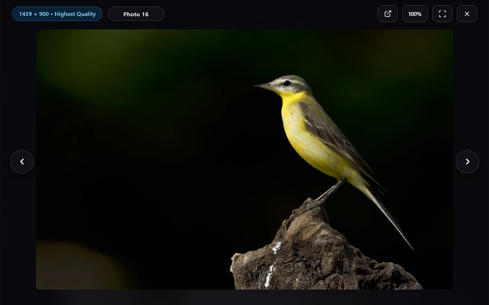
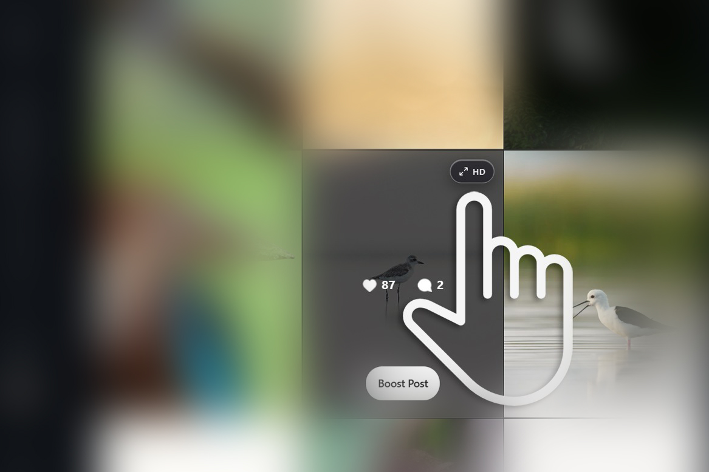

  

  # Immerse
  
  **Immersive Image Viewer for Instagram Web**

  

    Large-screen viewing with highest resolution images and intuitive fullscreen controls on Instagram.
  

## About The Project

Immerse is a lightweight browser extension that transforms your Instagram viewing experience. By loading the maximum quality source images and displaying them in a cinematic fullscreen overlay, Immerse lets you appreciate photography and visual art without the clutter and limited small sized image display of the standard web interface.

  

## Key Features

* **Maximum Fidelity**: Automatically fetches and renders the highest resolution image available from Instagram's servers, bypassing standard feed compression.
* **Cinematic Overlay**: Creates a distraction-free, large-screen environment that brings focus entirely to the images.
* **Seamless Integration**: Operates fluidly within the existing Instagram web layout with ability to navigate in the feed as a regular desktop image viewer.

## Supported Content

Immerse is focused on still photography and multi-image posts:
* **Feed Navigation**: Its primary focus is the instagram feeds, where it allows you to continuously navigate between posts as well as browse between individual images inside carousels.
* **Profile Grids**: Works seamlessly on user profile grids for opening and viewing posts. *Note: Carousel slide navigation is currently not supported when opening posts directly from a profile grid.*
* **Reels**: Video content and Reels are automatically filtered out to maintain a pure photography-focused experience.

  

## Keyboard Shortcuts

Navigate and control the viewer efficiently using these keyboard shortcuts:

| Key | Action |
| --- | --- |
| `Esc` | Exit fullscreen (if active), or close the viewer |
| `→` / `L` | Next Post |
| `←` / `J` | Previous Post |
| `↓` / `]` | Next Slide (Carousel) |
| `↑` / `[` | Previous Slide (Carousel) |
| `F` | Toggle Fullscreen |
| `V` | Open original post on Instagram |
| `+` / `=` | Zoom In |
| `-` / `_` | Zoom Out |
| `0` | Reset Zoom |

## Getting Started

### Installation

1. Download or clone this repository to your local machine.
2. Open Google Chrome(or any browser that supports chrome extensions) and navigate to your Extensions page (ex - for chrome: `chrome://extensions/`).
3. Toggle on **Developer mode** in the top right corner.
4. Click the **Load unpacked** button.
5. Select the root directory of the `Immerse` project.

## Contributing

Contributions are what make the open source community such an amazing place to learn, inspire, and create. Any contributions you make are **greatly appreciated**.

Please refer to [Contributing Guidelines](/docs/CONTRIBUTING.md) for detailed information on how you can help improve Immerse.

## Privacy

Immerse is built with privacy in mind. All image processing and UI enhancements happen locally on your device. The extension does not track your activity, collect personal data, or communicate with external analytics servers. 
